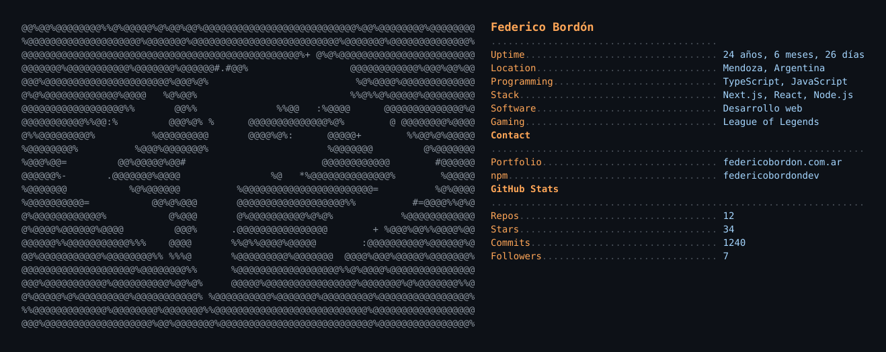

<picture>
  <source media="(prefers-color-scheme: dark)" srcset="dark_mode.svg">
  <source media="(prefers-color-scheme: light)" srcset="light_mode.svg">
  
</picture>

  <a href="https://federicobordon.com.ar">Portfolio</a> &nbsp;·&nbsp;
  <a href="https://www.linkedin.com/in/federicobordon/">LinkedIn</a> &nbsp;·&nbsp;
  <a href="https://www.npmjs.com/~federicobordondev">npm</a> &nbsp;·&nbsp;
  <a href="https://github.com/federicobordon09-dev?tab=repositories">Repositorios</a>

Este perfil se genera con scripts/build.mjs.

