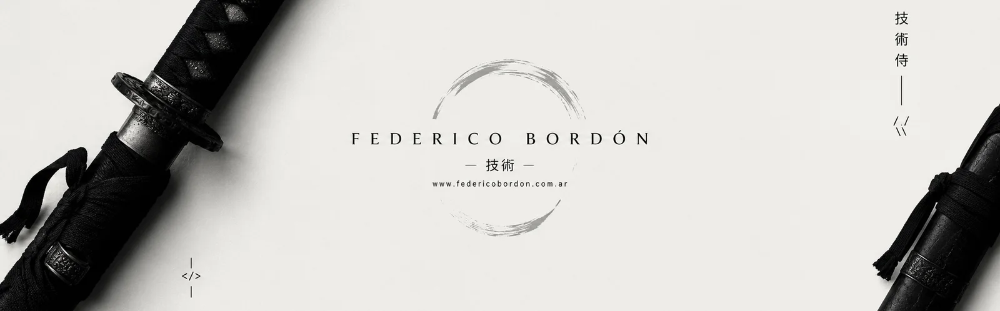
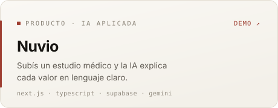
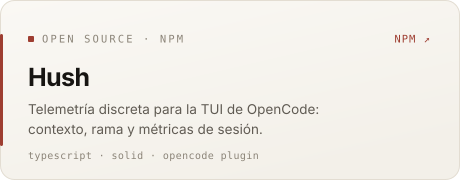
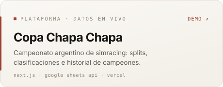
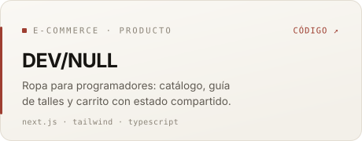
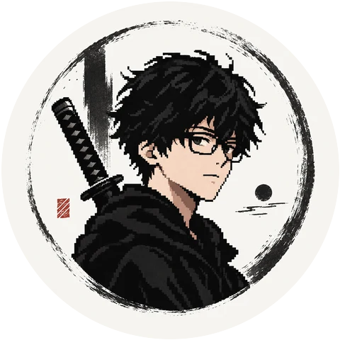
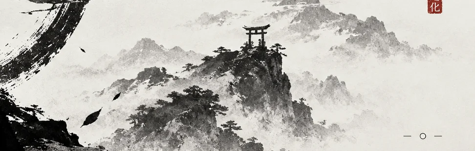

<picture>
  <source media="(prefers-color-scheme: dark)" srcset="assets/img/hero-dark.webp">
  
</picture>

  <a href="#stack">Stack</a> &nbsp;·&nbsp;
  <a href="#proyectos">Proyectos</a> &nbsp;·&nbsp;
  <a href="#sitios-y-landings">Sitios</a> &nbsp;·&nbsp;
  <a href="#cómo-trabajo">Cómo trabajo</a> &nbsp;·&nbsp;
  <a href="#contacto">Contacto</a>

**Construyo productos web completos, de la interfaz al deploy.**

Soy **Federico Bordón**, desarrollador full stack en **Mendoza, Argentina**. Trabajo con **Next.js, TypeScript y PostgreSQL**, y sumo inteligencia artificial cuando resuelve un problema real del producto.

Me importa el resultado completo: diseño, accesibilidad, rendimiento y lo que pasa después del deploy.

---

## Stack

  
  
  
  
  
  
  
  
  
  

---

## Proyectos

<table>
  <tr>
    <td width="50%" valign="top">
      <a href="https://nuvio-lemon-six.vercel.app">
        <picture>
          <source media="(prefers-color-scheme: dark)" srcset="assets/cards/nuvio-night.svg">
          
        </picture>
      </a>
    </td>
    <td width="50%" valign="top">
      <a href="https://www.npmjs.com/package/opencode-hush">
        <picture>
          <source media="(prefers-color-scheme: dark)" srcset="assets/cards/hush-night.svg">
          
        </picture>
      </a>
    </td>
  </tr>
  <tr>
    <td width="50%" valign="top">
      <a href="https://copachapachapa.vercel.app">
        <picture>
          <source media="(prefers-color-scheme: dark)" srcset="assets/cards/copa-chapa-chapa-night.svg">
          
        </picture>
      </a>
    </td>
    <td width="50%" valign="top">
      <a href="https://github.com/federicobordon09-dev/devnull-web">
        <picture>
          <source media="(prefers-color-scheme: dark)" srcset="assets/cards/devnull-night.svg">
          
        </picture>
      </a>
    </td>
  </tr>
</table>

- **Nuvio** — subís un PDF clínico y la IA explica cada valor en lenguaje claro, con chat por documento, comparación de estudios y evolución en el tiempo.
- **Hush** — plugin publicado en npm (`npm i opencode-hush`) que muestra contexto, rama y métricas de sesión en la TUI de OpenCode.
- **Copa Chapa Chapa** — toma los datos del campeonato desde Google Sheets y los publica en vivo: splits, clasificaciones e historial de campeones.
- **DEV/NULL** — tienda de indumentaria para programadores con catálogo, guía de talles y carrito con estado compartido.

El código de estos proyectos está público en [GitHub](https://github.com/federicobordon09-dev?tab=repositories).

---

## Sitios y landings

| Sitio | Qué es |
| :-- | :-- |
| **[Bodega Andeluna](https://bodega-andeluna.vercel.app)** | Rediseño conceptual del sitio de la bodega: catálogo de vinos, experiencias y lodge en tres idiomas (ES / EN / PT). |
| **[Opuntia](https://opuntia.vercel.app)** | Casa de té y pastelería en el Manzano Histórico: té en hebras, tortas caseras, reservas por WhatsApp y cómo llegar. |
| **[Hornero](https://hornerorestaurante.vercel.app)** | Landing para un restaurante de cocina al horno a leña en Los Chacayes: menú para compartir, cava y reservas. |
| **[Portfolio](https://federicobordon.com.ar)** | Mi sitio personal: proyectos, enfoque de trabajo y contacto, con i18n ES / EN. |

---

## Cómo trabajo

- **Verifico antes de afirmar.** Cuando el proyecto lo permite, cada cambio cierra con pruebas, typecheck y build; lo que no se ejecutó, se dice.
- **Diseño y accesibilidad desde el inicio.** Estados de carga, error y vacío forman parte del alcance, no del final.
- **Sin métricas inventadas.** Nada de testimonios, clientes ni números que no pueda sostener.
- **Alcance acotado y decisiones explícitas.** Cambios pequeños, revisados, con el motivo documentado.

---

## Contacto

  

  
  
  
  

Si tenés un proyecto en mente o querés charlar sobre un desarrollo, escribime.

<picture>
  <source media="(prefers-color-scheme: dark)" srcset="assets/img/band-dark.webp">
  
</picture>
